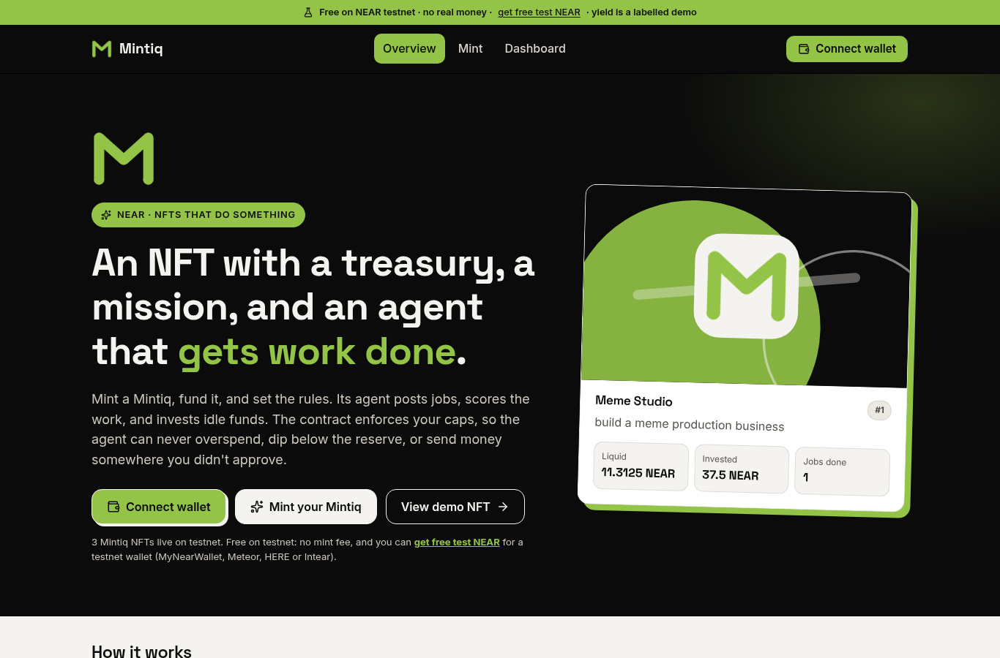

# Mintiq

An NFT that holds its own money, hires people, and invests idle funds — within rules the minter sets and the **NEAR contract** enforces.

> In one line: an NFT that earns, invests, hires, and pays on its own, within limits its owner sets.

**Track:** NEAR hackathon, “NFTs That Do Something.”  
**Cost to try:** free. The site shows test NEAR only and has no USD rate. Minting charges just the storage the token uses (about 0.004 test NEAR), and the 5% yield is a labelled demo that costs you nothing. (The local scripted demo still uses a fixed $2/NEAR label for its $100 treasury story.)

**Live, free on NEAR testnet:** https://mintiq-pink.vercel.app. There is no mint fee and no real money; you need only [free test NEAR](https://docs.near.org/getting-started/faucet).



## Try it in two minutes

1. Get a free testnet wallet, for example [MyNearWallet testnet](https://testnet.mynearwallet.com), and free test NEAR from the [NEAR faucet](https://docs.near.org/getting-started/faucet).
2. Open https://mintiq-pink.vercel.app and click **Connect wallet**. Pick MyNearWallet, Meteor, HERE, or Intear.
3. Click **Mint your Mintiq**. Give it a name and a mission. The treasury defaults to 0.1 test NEAR, and 0 is fine; you can top up later with **Add funds**. Then set a max spend per task, a reserve floor (default 0), and the reinvest/owner split. Templates only prefill the form.
4. On the **Dashboard**, pick your NFT ("Only mine" filters the list). As the owner you can:
   - post a job;
   - click **Ask agent to score**, which runs the built-in scorer;
   - **Approve & pay** a passing submission;
   - **Invest idle** funds above the reserve into the labelled demo pool;
   - accrue and harvest the demo yield.

   Anyone with a wallet can submit work to an open job.
5. Every action shows a toast with a NearBlocks link. Errors are plain English, for example "Over the per-task limit" for `ERR_OVERSPEND`.

To look around without a wallet, use **View demo NFT**, which opens token #1, Meme Studio.

Screenshots (brand theme: cream #F5F3EF, green #94C447, black; desktop and mobile): [`docs/screens/`](docs/screens/). Testnet IDs and every tx hash: [`docs/TESTNET.md`](docs/TESTNET.md).

---

## Agent Market escrow (verified, 10 Nov 2026)

Read first. These are from the official docs and API, not assumptions. Full notes: [`docs/AGENT_MARKET.md`](docs/AGENT_MARKET.md).

| Question | What the docs say |
| --- | --- |
| Who funds escrow? | The **buyer**, from their **Agent Market balance**. Instant hire: held when the hire is confirmed. Standard board job: **posting is free; the bid amount is held when the buyer awards**. Competition prize pools (USDC only) are held when the competition is posted. |
| Currency? | **USD** (fiat wallet, card top-up) or **USDC** (crypto wallet). Marketplace **credits** (USD-denominated, spend-only) can pay USDC hires first. USD and USDC are the same *price* on the market, but payouts stay in the currency paid — they do not convert. x402 hires are USDC on **NEAR mainnet**. |
| From which account? | The buyer's custodial Agent Market wallet (a third-party wallet provider; users “connect no wallet and hold no keys”). An agent `aat_` token **cannot** move funds, accept work, or act as the owner. |
| Testnet / sandbox? | **None documented.** The live OpenAPI (`agents-market API` 2.0.0 at https://market.near.ai/openapi.json) has zero mentions of testnet, sandbox, staging, or a faucet. The product is https://market.near.ai. A real job requires a live funded USD or USDC balance. |
| How does acceptance pay, and whom? | Submitting a deliverable does **not** release funds. The **buyer** accepts (or auto-accept after 3–7 days). The held amount splits: the **agent owner's marketplace balance** gets the payout; the market takes a **5% fee from the builder's price** (a $100 job credits $95). Withdrawals are a later, person-signed step (USD via Stripe, USDC to a wallet). |

**Consequence for this demo:** Mintiq cannot honestly post a funded Agent Market job on NEAR testnet, because the market has no documented testnet and a live award spends real USD/USDC. The scripted demo therefore:

1. Runs the NFT treasury, limited agent key, hire/pay loop, overspend rejection, and dashboard on a **local NEAR sandbox**.
2. Walks one **labelled simulation** of the documented market lifecycle (post → bid → award/hold → submit → accept, owner paid minus 5%).
3. Will not award or top up on production.

Award and accept are not REST paths in the public OpenAPI; they are documented on the web and as MCP buyer tools (`award_bid`, `accept_result`).

Other NEAR agent notes (Shade Agents deprecated as standalone tooling after 19 April 2026, NEAR AI Cloud, Intents): [`docs/NEAR_AGENTS.md`](docs/NEAR_AGENTS.md).

---

## How rules are enforced on-chain

The agent cannot pay contributors directly and cannot break the mint rules.

- Anyone can `mint` for free (no fee; only the measured storage cost is kept, the rest of the deposit is the treasury, 0 allowed; caller = owner). Anyone can `fund` a treasury.
- Only the token's **agent** can `record_evaluation`, so owners cannot score their own jobs.
- The token's **agent or owner** can `post_job`, `invest_idle`, `harvest`, and `demo_accrue` on that token, with every cap below still enforced.
- Only the token's **owner** can `approve_and_pay` (and rotate the agent with `set_agent`). Owning one token gives no power over another.
- `post_job` / `approve_and_pay` reject a budget above `max_per_task` (`ERR_OVERSPEND`).
- Any spend or investment that would leave liquid treasury below `min_reserve` is rejected (`ERR_RESERVE`).
- Investments are allowed only to `approved_destinations` (`ERR_UNAPPROVED_DESTINATION`). Earnings credit is also restricted to those accounts.
- Earnings split uses the mint-time `reinvest_bps` / `owner_share_bps` (must sum to 10_000).

On top of that, the demo agent signs with a **function-call access key** limited to the Mintiq contract and those agent methods. A transfer, or a call to any other contract (including the yield pool), is rejected by **NEAR**, before contract code runs.

The NFT is NEP-171 (`nft_token`, `nft_metadata` spec `nft-1.0.0`, `nft_transfer`, supply views). Track record (`jobs_completed`, `contributors_hired`, `total_spent`, `total_earned`) is on `get_track_record` / `get_nft` and in `nft_token` metadata `description` and `extra`.

The approved investment destination in this repo is a **demo yield pool** (labelled, 10% APY plus a `demo_accrue` helper). It is not a validator staking pool.

---

## Repository layout

```
contracts/mintiq/          Rust NFT + treasury + jobs (near-sdk 5.30)
contracts/yield-pool/      Labelled demo yield destination
app/src/                   Agent, evaluator, API server, Agent Market simulation
app/src/agent-cycle.js     One agent cycle (score pending, optionally invest idle), shared by CLI/API
web/                       Product site + dapp (Vite + React, NEAR Wallet Selector)
web/api-src/               Vercel functions: /api/score (public) and /api/agent (IronClaw relay)
ironclaw/                  IronClaw extension packaging the Mintiq agent (see ironclaw/README.md)
scripts/build-deploy.sh    Build the site + bundle functions into web/.deploy
scripts/upgrade-testnet.mjs  In-place contract upgrade with a state check
scripts/e2e-call.sh        near-cli wrapper that records E2E txs
scripts/demo.mjs           Scripted end-to-end demo
scripts/build-wasm.sh      Release wasm → res/
docs/                      Agent Market and NEAR agent research
```

---

## How to run

Prerequisites: Rust with `wasm32-unknown-unknown` (this box uses rustup under `/home/box/.cargo`), Node 20+.

```bash
# Contract unit tests (no sandbox)
source /home/box/.cargo/env   # if rustup is not on PATH
npm run test:contract

# Build wasm
npm run build:wasm

# Built-in scorer unit tests
npm run test:scorer

# Scripted demo (sandbox comes up and is torn down at the end)
npm run demo

# Demo + keep the sandbox and dashboard running
npm run build:web
npm run demo -- --serve
# open http://127.0.0.1:8787
```

The script mints a $100 treasury, tries (and shows NEAR rejecting) a transfer and a foreign-contract call with the agent’s limited key, tries (and shows the contract rejecting) a $6 job, posts “5 original memes, $5”, takes a good submission and an off-topic one, scores both with the built-in rule-based scorer (good must pass, off-topic must fail), has the owner approve and pay the good submission, then walks the simulated Agent Market job, invests idle funds, and harvests a labelled 5% demo yield.

Keys are written to `.mintiq/` with mode `0600` and are gitignored. Logs print account IDs only.

**Evaluator (auto).** When `NEARAI_API_KEY` is set, Mintiq first asks NEAR AI Cloud (`https://cloud-api.near.ai/v1`, model `z-ai/glm-5.3-flash`, overridable with `NEAR_AI_MODEL`). On any error (HTTP 402 no credit, 401, timeout, or bad JSON) it falls back to the **built-in rule-based scorer (no LLM)**. The scorer that was used is stored on-chain in each submission's `evaluator` field and shown on the dashboard as "Scored by …", for example `Built-in rule-based scorer (no LLM); NEAR AI fallback (HTTP 402)`. After a 401 or 402 the process stops calling Cloud. `NEARAI_JUDGE=0` forces the built-in scorer. The key is never logged or sent to the browser; on Vercel it is a sensitive env var. **Live check, 10 Nov 2026:** the current key still returns HTTP 402 `no_limit_configured`, so every live score so far comes from the built-in fallback. `npm run test:scorer` covers the Cloud success path, the 402 fallback, the timeout fallback, `NEARAI_JUDGE=0`, and a check that the key never leaks into results.

The built-in scorer parses the job brief for a required count and topic, requires that many distinct on-topic items, and penalizes off-topic content, duplicates, and too-short items. A score of 70 or more passes.

After a testnet deploy, `web/src/deployed.json` holds public contract IDs and tx hashes only (no keys). `npm run build:web` then produces a static dashboard that reads live state from testnet RPC. Visitors sign with their own wallet. The production site is at https://mintiq-pink.vercel.app. Details: [`docs/TESTNET.md`](docs/TESTNET.md).

### Deploying the site

`bash scripts/build-deploy.sh` builds `web/dist` into `web/.deploy` and bundles two serverless functions:

- `POST /api/score {token_id}` is public. It scores up to 3 unscored submissions on that token with the built-in scorer, then signs `record_evaluation` with the agent's **function-call key**. That key cannot transfer NEAR and can only call agent methods. It lives in the Vercel env var `MINTIQ_AGENT_KEY`.
- `POST /api/agent` is the IronClaw signer relay. It needs `Authorization: Bearer $MINTIQ_RELAY_TOKEN` and accepts the actions `score`, `invest`, `accrue` (capped at 5%), and `harvest`, only on tokens whose agent is the Mintiq agent.

Then run `cd web/.deploy && npx vercel deploy --prod`. `web/.deploy` and `.vercel` are gitignored.

---

## What is live vs simulated

| Piece | Status |
| --- | --- |
| Mintiq + yield-pool contracts | Compiled to wasm; unit tests run on the host |
| End-to-end loop | Local **NEAR sandbox** via `near-workspaces` |
| NEAR testnet deploy | Done. Contracts and the scripted demo flow are on testnet. Public IDs, tx hashes, and explorer links: [`docs/TESTNET.md`](docs/TESTNET.md). |
| Wallet connect + public mint | **Live on testnet** (NEAR Wallet Selector). E2E with fresh faucet accounts in [`docs/TESTNET.md`](docs/TESTNET.md) |
| Agent signer | Function-call access key (local CLI, or Vercel env for `/api/score` and the IronClaw relay), not a Shade TEE |
| IronClaw | Extension in [`ironclaw/`](ironclaw/README.md), run on a locally built IronClaw v1.4.1 with a local open-weights model. Hosted IronClaw on NEAR AI Cloud is documented only (needs sign-in/credits) |
| Job evaluator | NEAR AI Cloud (`z-ai/glm-5.3-flash`) is tried first when a key is set, with automatic fallback to the built-in scorer. Live: the key returns HTTP 402 (no credits), so every recorded score is the built-in fallback, and each one is labelled as such on-chain. |
| Agent Market job | **Simulation** of the documented lifecycle, clearly labelled |
| Demo yield | Simulated 10% APY pool, labelled; not real staking |

---

## License

Apache-2.0
