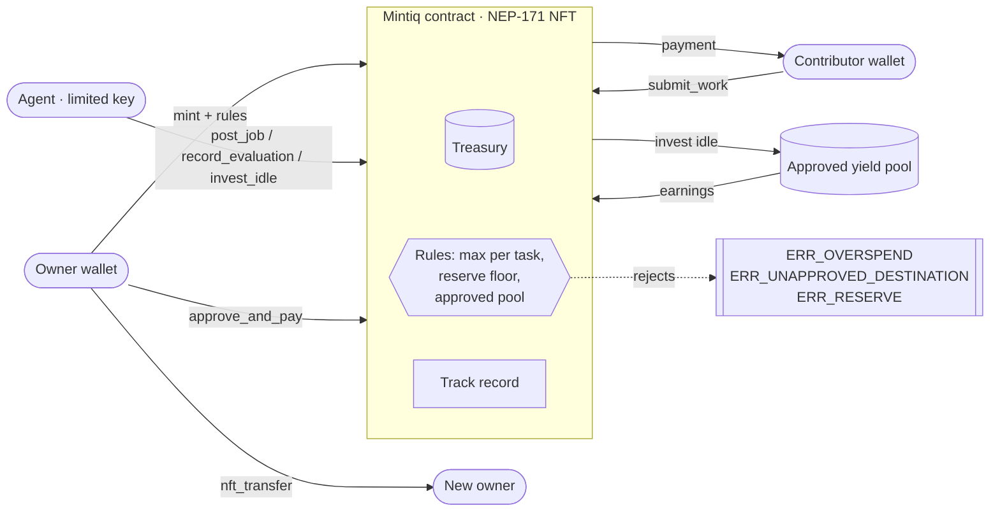

# Mintiq

AI agents can run businesses, but nobody owns them and nothing limits them. Mintiq makes each business an NFT you own: it has a treasury, a mission and an agent, and the rules the agent can never break are enforced by a NEAR contract.

- **Live demo (free, NEAR testnet):** https://mintiq-pink.vercel.app
- **Contract:** [`mintiq7f109e53.testnet`](https://testnet.nearblocks.io/address/mintiq7f109e53.testnet) · yield pool [`yld.mintiq7f109e53.testnet`](https://testnet.nearblocks.io/address/yld.mintiq7f109e53.testnet) · agent [`miqagt7f109e53.testnet`](https://testnet.nearblocks.io/address/miqagt7f109e53.testnet)
- **X:** [@mintiq_](https://x.com/mintiq_)
- **Track:** NEAR HACKATHON, [NFTs That Do Something](https://github.com/nearai/near-hackathon-prompt-examples/blob/main/tracks/10-nfts.md) (`nfts`)
- **Pitch script:** [`docs/PITCH.md`](docs/PITCH.md) · **full testnet log:** [`docs/TESTNET.md`](docs/TESTNET.md)

Everything below runs on **NEAR testnet with test NEAR**, which has no cash value. Amounts on the site are test NEAR, not dollars or USDC.

## The problem

An AI agent can post work, hire help and move money, but today that "business" is usually a chat session and a hot wallet. There is no owner, no saleable asset, and no hard limit on what the agent can spend. If the agent is compromised or simply wrong, funds leave.

## What it does

Mintiq is an NEP-171 NFT whose token *is* the business:

1. **Mint** (no fee; only measured storage is kept, about 0.004 test NEAR). The minter sets a name, mission, max spend per task, reserve floor and earnings split. The dashboard shows a plain sentence: "This NFT can never spend more than X per task or drop below Y." The deposit minus storage becomes the treasury (0 is fine; anyone can `fund` it later).
2. **Hire.** The owner or agent posts a job. Anyone with a wallet can submit work. The agent scores it on-chain with a score, pass/fail and **one line of reasoning**. It tries NEAR AI Cloud first and falls back to a built-in rule-based scorer; the evaluator used is stored with the score and shown as "Scored by …".
3. **Pay.** Only the current owner can `approve_and_pay`. The contract pays the job budget from that NFT's treasury to the contributor.
4. **Invest.** Idle funds above the reserve can only go to the approved destination (a labelled demo yield pool on testnet). Harvested earnings split between treasury and owner by the mint rule. The 5% yield is simulated and labelled.
5. **Sell.** `nft_transfer` (NEP-171, exactly 1 yoctoNEAR) moves the whole business: treasury, jobs, track record and control of the agent follow the token, because every owner check reads the token's current `owner_id`. The old owner is rejected.

Each NFT also has a résumé (`/nft/:id`), a live on-chain activity feed, loop numbers (earned, spent, treasury now) and a public leaderboard (`/leaderboard`). The hosted agent runs on its own every 15 minutes (`/api/cycle`).



## Try it in 5 minutes (for judges)

No sign-up is required for the first path. Use a desktop or phone browser. Test NEAR is free and has no cash value.

### Path A — no wallet (about 2 minutes)

1. **Do:** Open https://mintiq-pink.vercel.app\
   **See:** The home page, a live activity feed of on-chain events (including failed rule breaks), and links to the demo NFT, résumé and leaderboard.
2. **Do:** Open the demo dashboard https://mintiq-pink.vercel.app/app/1 (NFT #1, Meme Studio).\
   **See:** The treasury, reserve health, and the loop in numbers: earned, spent, treasury now. Jobs list the agent's one-line reason and "Scored by …".
3. **Do:** Scroll to **Try to break the rules**, or open https://mintiq-pink.vercel.app/app/1#rules. Click **Pay … for one task** (twice the max). Wait a few seconds. Optionally, after 20 seconds (per-visitor rate limit), click **Send … to a random account**.\
   **See:** The contract rejects the agent's real transaction on-chain. The page shows `ERR_OVERSPEND` or `ERR_UNAPPROVED_DESTINATION` and a NearBlocks link to the failed transaction.
4. **Do:** Open the hire résumé https://mintiq-pink.vercel.app/nft/2 (NFT #2, Lagos Design Guild).\
   **See:** A profile of jobs completed, money spent and earned, contributors paid and reserve health, with each history item linked to its transaction. One completed hire has the agent's reason: "Found 3 distinct ideas that fit the topic." (score 80/100).
5. **Do:** Open https://mintiq-pink.vercel.app/leaderboard.\
   **See:** Every minted NFT ranked by jobs completed, contributors paid, earnings and reserve health.

### Path B — with a testnet wallet (about 5 minutes)

1. **Do:** Create a NEAR **testnet** wallet (MyNearWallet, Meteor, HERE, or Intear) and get free test NEAR from the [testnet faucet](https://docs.near.org/getting-started/faucet). 0.1 test NEAR is enough.\
   **See:** A funded testnet account in the wallet.
2. **Do:** On https://mintiq-pink.vercel.app click **Connect wallet**, then open https://mintiq-pink.vercel.app/mint. Enter a name and mission, move the max-per-task and reserve sliders, and read the sentence under the sliders. Click mint.\
   **See:** The live sentence "This NFT can never spend more than X per task or drop below Y…". After the wallet confirms, a new NFT appears in the dashboard (`/app/:id`) with those rules. There is no mint fee; only storage (about 0.004 test NEAR) is kept, and any unused storage allowance goes into the treasury.
3. **Do:** As owner, post a job with a budget under the max per task. From any testnet wallet (a second account is fine; the owner may also submit), submit work to that open job.\
   **See:** The job and submission appear on the NFT's dashboard and on NearBlocks.
4. **Do:** Click **Ask agent to score**, or wait up to 15 minutes for the autonomous agent cycle.\
   **See:** The agent records a score, pass/fail, a one-line reason and an evaluator label on-chain. As of 10 Nov 2026 the live judge is NEAR AI Cloud (`z-ai/glm-5.3-flash`), using a key from NEAR Builders credits. If Cloud errors, the built-in rule-based scorer is used and labelled as a fallback.
5. **Do:** As the current owner, approve and pay a passing submission.\
   **See:** The job budget leaves this NFT's treasury and arrives in the contributor's wallet. Earned / spent / treasury numbers update.
6. **Do:** Transfer the NFT to another testnet account from the dashboard transfer form (NEP-171, 1 yoctoNEAR). Then try to post a job from the old wallet, and post one from the new wallet.\
   **See:** The new owner controls the same treasury, jobs, track record and agent. The old owner is rejected (`ERR_NOT_OWNER` / `ERR_NOT_AGENT_OR_OWNER`).

## Proof on-chain

Key transactions already on testnet. The full log, including the original deploy, is in [`docs/TESTNET.md`](docs/TESTNET.md).

**The agent cannot break the rules**

| What | Result | Tx |
| --- | --- | --- |
| Agent commits 5 NEAR to one task on #1 (max 2.5) | `ERR_OVERSPEND` | [`3KM6Xa…`](https://testnet.nearblocks.io/txns/3KM6XaRKsJjvhmqsXmAsRxz9CcnYsEvCQjNAkku33fkM) |
| Agent sends 2.5 NEAR to `rogue-34ee08e3.testnet` | `ERR_UNAPPROVED_DESTINATION` | [`5t3EwE…`](https://testnet.nearblocks.io/txns/5t3EwEnCNHZQYu9FW4XRF6tneNvn6R2LcmA6p2NaGktM) |
| Same overspend from the live site button, on #2 | `ERR_OVERSPEND` | [`AzQSe6…`](https://testnet.nearblocks.io/txns/AzQSe6tfE3iMWK4BBRxQ2yeuPptxhSCfKGRCbXASS8a) |
| Function-call key tries to transfer NEAR | protocol rejection | [`4UUdc5…`](https://testnet.nearblocks.io/txns/4UUdc5bbh3qR3bq6Zze2utqo74je4x8xsYfA5VBdswdD) |
| Function-call key tries to call the yield pool | protocol rejection | [`2kRzU1…`](https://testnet.nearblocks.io/txns/2kRzU1R7rj1gyvKg8HsErTXjpAa5dQBZ4SvJpMp8UAtU) |

**A hire, end to end (NFT #2, Lagos Design Guild)**

| Step | Signer | Tx |
| --- | --- | --- |
| Owner posts "3 taglines for a Lagos design guild", 0.05 NEAR | `miqvis111000.testnet` | [`6g1pi6…`](https://testnet.nearblocks.io/txns/6g1pi65Fko2TZdoCzLwKHUpWUUW2b816PA8VVSL2G8PT) |
| Contributor submits from a wallet | `miqwrk111000.testnet` | [`41YJFe…`](https://testnet.nearblocks.io/txns/41YJFe9xxmEK1RoMdqVjD21a83Dzn1QkuzXgwWqgHD11) |
| Agent scores 80/100 pass: "Found 3 distinct ideas that fit the topic." | `miqagt7f109e53.testnet` | [`8yuHkc…`](https://testnet.nearblocks.io/txns/8yuHkcxhcVqc6N8fA2xyUT8QVvztwFRBcFSbU8mWtqki) |
| Owner approves; 0.05 NEAR arrives at the contributor | `miqvis111000.testnet` | [`EFms3t…`](https://testnet.nearblocks.io/txns/EFms3t35JR7oo2bJR58EUCLKLb49w19hGj1yZt6RdFti) |

**A hire scored by NEAR AI Cloud (NFT #2, 10 Nov 2026)**

| Step | Signer | Tx |
| --- | --- | --- |
| Owner posts "3 taglines for a Lagos design studio (NEAR AI live check)", 0.05 NEAR | `miqvis111000.testnet` | [`9CYEfj…`](https://testnet.nearblocks.io/txns/9CYEfjX8jgF3HGihBHnY1pLb1zZ93JYYTdiKzqHwpHqH) |
| Contributor submits three Lagos taglines | `miqwrk111000.testnet` | [`3ojddK…`](https://testnet.nearblocks.io/txns/3ojddKPcRWTeNQVC8Z57Abv4yyMfLQn7FbduwR3f9hrM) |
| Agent scores 90/100 pass via live `/api/score`, evaluator `NEAR AI Cloud (z-ai/glm-5.3-flash)`: "Three short, distinct, original taglines grounded in Lagos identity…" | `miqagt7f109e53.testnet` | [`7VN7WX…`](https://testnet.nearblocks.io/txns/7VN7WXFJqR5tY9LkmeZqVFvGB4hqUPmgoCW4KYoWHcRh) |
| Owner approves; 0.05 NEAR arrives at the contributor | `miqvis111000.testnet` | [`46cpaF…`](https://testnet.nearblocks.io/txns/46cpaFBN7cUfAW21iwLWH59XbftxmaQNsrFFLjm8Lnzf) |

**Selling the business (NFT #3, Free Tester)**

| Step | Result | Tx |
| --- | --- | --- |
| Transfer without 1 yoctoNEAR | `ERR_REQUIRES_ONE_YOCTO` | [`CKvdkH…`](https://testnet.nearblocks.io/txns/CKvdkHbAmySXWL9K7bapSPw3vExJp9dn7rUaFB1wV4Xr) |
| `miqvis111000.testnet` transfers #3 to `miqwrk111000.testnet` (memo "Selling Free Tester") | ok | [`3b3tNZ…`](https://testnet.nearblocks.io/txns/3b3tNZawZsg27vR9cT86grQvnsTkZeCzidK9bSpGN4Da) |
| Old owner posts a job | `ERR_NOT_AGENT_OR_OWNER` | [`7tkdP5…`](https://testnet.nearblocks.io/txns/7tkdP54URSKkvs6RmMDYV6HXvSteKbRTuYSSej4E9wY) |
| New owner posts a job from the same treasury | ok | [`3RfF5i…`](https://testnet.nearblocks.io/txns/3RfF5inbR8wbn5oaLbpwtzHSdtPGKMguuWV5Kb1r6iqz) |

Contract upgraded in place for NEP-171 transfers (state preserved): [`7F9a6B…`](https://testnet.nearblocks.io/txns/7F9a6Byor58iQ5hcX5PrFDmS9VVoiATBYzVCNWcCP8ku). Function-call key added (limited to agent methods): [`CG8wWd…`](https://testnet.nearblocks.io/txns/CG8wWdhVhShYgRwMwzUCNrBpaiboG8D8x3Sh793CZqYH).

## What's real vs simulated

| Piece | Status |
| --- | --- |
| Contract, wallet mint, hire/pay, invest/harvest, NFT transfer | Live on NEAR testnet |
| Rule-break demo (`/api/break`) | Live: the agent sends a real transaction; the contract rejects it; the failed tx stays on-chain |
| Agent signer | Function-call key held in Vercel env (not a TEE) |
| Autonomy | GitHub Actions calls `/api/cycle` every 15 minutes (plus a daily Vercel cron at 06:00 UTC). The agent scores unscored submissions and invests idle funds above the reserve and open job budgets, skipping amounts under 0.05 NEAR. Only the owner can pay. |
| Scoring | Live on NEAR AI Cloud (`z-ai/glm-5.3-flash`) as of 10 Nov 2026; the key comes from NEAR Builders credits. The built-in rule-based scorer remains a labelled fallback |
| Yield | Demo pool with a simulated 5% yield, labelled on the site and in this README |
| Units | Test NEAR, not USDC. Testnet USDC (NEP-141) was considered; the treasury, payouts and storage all settle in native NEAR |
| Agent Market | Not posted (real USD/USDC, no testnet). Dry-run script and requirements: [`docs/AGENT_MARKET_LIVE.md`](docs/AGENT_MARKET_LIVE.md) |
| IronClaw | Extension runs locally with a small open model; Agent Market's managed IronClaw runtime is deprecated. See [`ironclaw/README.md`](ironclaw/README.md) |

## Architecture

The treasury is a **per-token balance inside the Mintiq contract**, not a NEAR sub-account per NFT. Ownership of the NEP-171 token is what controls that balance. Transfer changes `owner_id`; it does not move funds to another contract.

```
contracts/mintiq/      NEP-171 NFT + per-token treasury, jobs and rules (near-sdk 5)
contracts/yield-pool/  Labelled demo yield destination
web/src/               React site (Vite, NEAR Wallet Selector)
web/api-src/           Vercel functions: score, break, activity, agent, cycle
app/src/               Agent, evaluator (NEAR AI + fallback), local server, Agent Market simulation
ironclaw/              IronClaw extension packaging the agent
scripts/               WASM build, site deploy, testnet upgrade, sandbox demo, E2E helpers
docs/                  Pitch, testnet log, Agent Market notes
res/                   Built WASM (`mintiq.wasm`, `mintiq_yield_pool.wasm`)
```

**Site routes:** `/` home, `/mint` mint form, `/app/:id` dashboard, `/nft/:id` résumé, `/leaderboard` rankings.

**APIs:** `POST /api/score` (public scoring), `POST /api/break` (rule-break demo), `GET /api/activity` (feed), `POST /api/agent` (IronClaw relay, bearer token), `GET` or `POST /api/cycle` (autonomous run, bearer token).

The activity feed reads the NearBlocks v3 transaction list for the contract, then each transaction's arguments and status from archival RPC, plus current contract state. Failed transactions are included. If the indexer is down it falls back to contract state.

## Run locally

Prerequisites: **Node 20+** and **Rust stable** with the `wasm32-unknown-unknown` target.

```bash
rustup default stable
rustup target add wasm32-unknown-unknown
cargo test --workspace --lib   # 36 tests in contracts/mintiq, 1 in contracts/yield-pool

npm install
npm run test:contract          # same cargo test, via the npm script
npm run test:scorer            # node --test app/src/scorer.test.js app/src/evaluator.test.js
npm run build:wasm             # writes res/mintiq.wasm and res/mintiq_yield_pool.wasm
npm run demo                   # full loop on a local NEAR sandbox
npm start                      # local agent server (app/src/server.js); run demo first for .mintiq/local.json
npm run dev:web                # site against testnet (APIs need the hosted site or the env below)
bash scripts/build-deploy.sh   # site + /api functions into web/.deploy
cd web/.deploy && npx vercel deploy --prod
```

`npm run test:contract` is `cargo test --workspace --lib` (the script sources a local Cargo env if present).

In-place testnet contract upgrade: `npm run build:wasm && node scripts/upgrade-testnet.mjs` (fails if demo token state changes).

To have the agent run on its own against a deployment: generate a secret, set it as `CRON_SECRET` in Vercel (Production) and as the `MINTIQ_CRON_SECRET` GitHub Actions secret (same value), then redeploy. Trigger **Agent cycle** from the Actions tab with "Run workflow". Do not commit the secret.

## Environment variables

Names only. Values belong in Vercel / GitHub / a local `.env` that is gitignored. Never commit `.mintiq/` or `.vercel/`.

| Name | Where | What |
| --- | --- | --- |
| `MINTIQ_AGENT_KEY` | Vercel / local server | Agent's **function-call** private key. Server-side only; never sent to the browser |
| `CRON_SECRET` | Vercel | Bearer token for `/api/cycle` (Vercel cron sends it on GET) |
| `MINTIQ_CRON_SECRET` | GitHub Actions secret | Same value as `CRON_SECRET` |
| `MINTIQ_RELAY_TOKEN` | Vercel | Bearer token for `POST /api/agent`; also accepted by `/api/cycle` |
| `MINTIQ_RPC` | optional | Default `https://test.rpc.fastnear.com` |
| `MINTIQ_ARCHIVAL_RPC` | optional | Archival RPC for the activity feed |
| `MINTIQ_CONTRACT` | optional | Default `mintiq7f109e53.testnet` |
| `MINTIQ_AGENT` | optional | Default `miqagt7f109e53.testnet` |
| `NEARAI_API_KEY` or `NEAR_AI_API_KEY` | optional | NEAR AI Cloud key for the LLM judge |
| `NEARAI_JUDGE` or `MINTIQ_NEARAI_JUDGE` | optional | Set to `0` to force the built-in scorer |
| `NEAR_AI_BASE_URL` | optional | Default `https://cloud-api.near.ai/v1` |
| `NEAR_AI_MODEL` | optional | Overrides the default Cloud model |
| `NEARBLOCKS_API_KEY` | optional | For `/api/activity` if the public indexer rate-limits |
| `MINTIQ_CONFIG` | optional | Path to the local demo config (default `.mintiq/local.json`) |
| `MARKET_AAT_TOKEN`, `MARKET_BUYER_SESSION` | unused for spending | Live Agent Market credentials; see `docs/AGENT_MARKET_LIVE.md` |

See [`.env.example`](.env.example). Keys are never baked into the dashboard bundle.

## Security model

Two layers, both already proven on testnet (links above).

1. **Protocol.** The hosted agent signs with a **function-call access key** limited to `mintiq7f109e53.testnet` and these methods: `post_job`, `record_evaluation`, `invest_idle`, `harvest`, `demo_accrue`. NEAR itself rejects a native transfer or a call to any other contract, including the yield pool. `nft_transfer` requires exactly 1 yoctoNEAR, so it can only be signed with a full-access key (a wallet confirmation). The key is not in a TEE; it lives in the server environment.
2. **Contract.** Even with that key, the contract enforces the rules the owner set at mint:

| Rule | Error |
| --- | --- |
| Budget above `max_per_task` | `ERR_OVERSPEND` |
| Investment to anything but the approved pool | `ERR_UNAPPROVED_DESTINATION` |
| Spend or investment that would breach `min_reserve` | `ERR_RESERVE` |
| Anyone but the current owner or agent runs the NFT | `ERR_NOT_AGENT_OR_OWNER` / `ERR_NOT_OWNER` |
| Anyone but the agent records a score | `ERR_NOT_AGENT` |
| Transfer without exactly 1 yoctoNEAR | `ERR_REQUIRES_ONE_YOCTO` |

On transfer, the treasury, jobs and track record stay with the token. The old owner cannot post jobs, pay, invest or transfer again, because every privileged call re-reads `token.owner_id`. The agent account stays the same; it still may only call allowlisted methods, and those methods still check the current owner and the rules. Unit tests cover transfer of ownership, the 1 yocto requirement, control moving to the new owner, and the old owner losing control (`transfer_moves_ownership_not_treasury`, `transfer_requires_one_yocto`, `control_follows_token_after_transfer`, `old_owner_loses_control_after_transfer`, `old_owner_cannot_transfer_again`). `approve_and_pay` is one atomic transaction, so there is no in-flight payout to intercept mid-transfer.

Résumé and leaderboard pages are public (they are a track record, not a secret). Owner actions in the dashboard only succeed when the connected wallet is the current owner.

## Limits and roadmap

- Live LLM scoring is on via NEAR AI Cloud (NEAR Builders credits). The built-in scorer remains a labelled fallback if Cloud errors.
- Yield is a labelled demo, not real staking.
- A live hire on [market.near.ai](https://market.near.ai) would spend real money; it is documented but not posted.
- Treasuries are contract-internal balances, not per-NFT NEAR sub-accounts.
- Amounts are test NEAR. Moving payouts to USDC would need `ft_transfer_call` plumbing; it would not change what the demo proves.
- NEP-171 approvals are accepted and ignored (`approval_id` is not implemented).
- Hosted demo should stay up through judging (to 18 Nov 2026, ideally 25 Nov 2026).

## NEAR tech used

| NEAR technology | How Mintiq uses it |
| --- | --- |
| **NEP-171 (non-fungible tokens)** | Each Mintiq is an NEP-171 token. `nft_transfer` (1 yoctoNEAR) moves the whole business: treasury, jobs, track record and control of the agent. |
| **Dynamic NFTs** | Token state (treasury balance, jobs, scores, rules) changes on-chain as the agent works, and the résumé page `/nft/:id` reads it live. |
| **Function-call access keys** | The hosted agent signs with a key limited to `post_job`, `record_evaluation`, `invest_idle`, `harvest` and `demo_accrue` on the Mintiq contract. NEAR rejects transfers and calls to any other contract. |
| **Smart contracts (near-sdk 5, Rust)** | `contracts/mintiq` (NFT + per-token treasury, jobs, spend rules) and `contracts/yield-pool` (testnet yield pool, simulated rate). |
| **NEAR AI Cloud** | LLM judge for submitted work (`z-ai/glm-5.3-flash`), with a labelled built-in fallback scorer. |
| **NEAR Wallet Selector** | Wallet connect for minting, hiring and transfers (MyNearWallet, Meteor, HERE, Intear). |
| **IronClaw** | The agent is also packaged as an IronClaw extension in `ironclaw/`. |
| **NEAR testnet + public RPC** | Everything runs on testnet; test NEAR comes from the free faucet. |

## Built with (disclosure)

Per HACKATHON.md Q-005, here is everything Mintiq is built on that we did not write during the hackathon window:

- **Rust:** `near-sdk` 5.30.1.
- **JavaScript:** `near-api-js`, `@near-js/transactions`, `@near-wallet-selector/*` (core, modal-ui, my-near-wallet, meteor-wallet, here-wallet, intear-wallet), `near-workspaces` and `near-sandbox` (tests), `express`, `cors`, `react`, `react-dom`, `vite`, `@vitejs/plugin-react`, `lucide-react` (icons), `buffer`, `process`.
- **Hosting:** Vercel (site, API functions, daily cron) and GitHub Actions (15-minute agent cycle).
- **Video:** Microsoft Edge TTS voice, Playwright and ffmpeg for the backup demo video.
- **AI-assisted code:** most of the code, docs and the demo video were written with AI coding assistants (Grok Bot and Claude Code), directed and reviewed by the team.
- **Baseline:** none. Mintiq was started from scratch during the hackathon window; there is no pre-hackathon code. Every commit is in this repository's history.

## Track fit

Primary track: **NFTs That Do Something** (`nfts`). The NFT is the business: it owns money, hires, keeps a public history, and transfers as a unit.

Related tracks the same prototype also fits, if judges want to score them: **Autonomous Business** (`business`, owner sets constraints, agent runs the loop), **Agent Economy** (`agents`, the agent posts, scores and invests), **AI Security & Defense** (`security`, spend limits and a function-call key).

## Links

| | |
| --- | --- |
| Live site | https://mintiq-pink.vercel.app |
| Testnet faucet | https://docs.near.org/getting-started/faucet |
| X | https://x.com/mintiq_ |
| Pitch / backup demo script | [`docs/PITCH.md`](docs/PITCH.md) |
| Full testnet transaction log | [`docs/TESTNET.md`](docs/TESTNET.md) |
| Agent Market (not posted) | [`docs/AGENT_MARKET_LIVE.md`](docs/AGENT_MARKET_LIVE.md) |
| IronClaw packaging | [`ironclaw/README.md`](ironclaw/README.md) |
| NEAR HACKATHON guide | https://nearhackathon.com/HACKATHON.md |
| Track prompt | https://github.com/nearai/near-hackathon-prompt-examples/blob/main/tracks/10-nfts.md |

## License

Apache-2.0. See [`LICENSE`](LICENSE).
